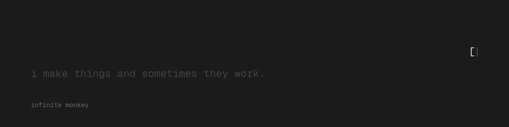

<picture>
  <source media="(prefers-color-scheme: dark)" srcset="github-header-dark.webp">
  <source media="(prefers-color-scheme: light)" srcset="github-header-light.webp">
  
</picture>

monkey will take 1088 more keystrokes to type it. <strong>maybe!</strong>
